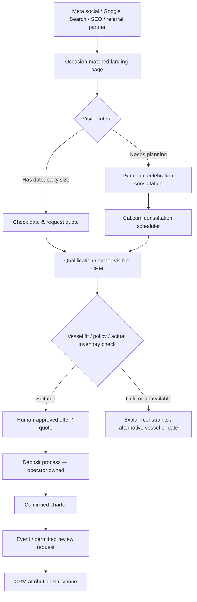

# Celebration appointment & charter booking funnel

## Primary conversion routes

**Critical:** Cal.com appointment slots represent staff consultation time, **not** real-time charter inventory. A form or booking confirmation cannot claim a reserved yacht until vessel availability, quote acceptance and deposit rules are verified by the operator.

## Funnel UI / wireframe
1. Mobile-first hero: “Celebrate [occasion] aboard a private Vancouver yacht.” Authentic vessel video/photo + “Check your date” CTA.
2. Occasion selector: Birthday / Milestone / Graduation / Bachelor / Bachelorette / Bridal / Retirement / Friends / Anniversary / New Beginnings / Corporate / Other.
3. Evidence: real vessel cards, validated capacity, genuine reviews with permission, policy summary; no fictional testimonials.
4. Decision fork: **Request availability & quote** (primary) / **Book a planning call** (secondary).
5. Qualifier: desired date (and alternate), occasion, guests, budget range optional, boat preference optional, email, phone optional/required per chosen communication route, consent/privacy notice.
6. Thank-you: clear next step and response-hours promise only if operationally supported.
7. Calendar: valid consultation times, confirmation and reminders; appointment stage in CRM.
8. Quote: custom charter proposal, inclusions, fees, weather/cancellation terms and deposit instructions, all human approved.

## CRM pipeline
New Inquiry → Verified/Qualified → Consultation Offered → Appointment Scheduled → Attended → Quote Sent → Deposit Pending → Confirmed Charter. Side exits: Unresponsive, Not Fit, Unavailable, Lost Price, Cancelled, No-show; keep reasons and dates.

## Lead qualification model
BANT adapted to events: **Budget** (optional initially), **Authority** (organizer/approver), **Need** (occasion, experience, group count), **Timeline** (charter date); additionally **vessel fit** and **inventory**. Suggested score 0–100: event date 20; capacity fit 20; budget compatibility 20; event horizon 15; quote interest 15; consultation booked 10. Score is a prioritization heuristic, not booking probability.

## SLA & workflow
- New lead: log source + campaign + UTM + gclid/fbclid where privacy permissions allow; acknowledgment immediately when connected; staffed response target <=5 minutes.
- Quote request: human validates vessel availability/operational requirements before committing.
- Consultation booked: Cal.com event; transactional Resend confirmation; Twilio reminder only when permitted and opted-in as required.
- 24h and 2h reminders (test cadence); 48h human-reviewed quote follow-up; no automatically sent cold marketing.
- No-show: one respectful reschedule option; route to human if repeated.
- Closed-won: record actual deposit, booked gross revenue, expected/actual margin and vessel. Avoid double-counted attribution.

## Supabase implementation contract (proposal, not deployed)
`campaigns` (id, client_id, slug, channel, UTM labels, state);
`inquiries` (id, client_id, campaign_id, occasion, event_date, alternative_date, guests, budget_band, source_url, consent_scope, status, created_at);
`consultations` (id, inquiry_id, cal_event_id, starts_at, state);
`charter_quotes` (id, inquiry_id, vessel_id, total_cad, margin_estimate, quote_version, approved_by, status);
`charter_bookings` (id, quote_id, vessel_id, charter_start, deposit_cad, revenue_cad, status);
`message_events` (id, inquiry_id, channel, consent_basis, template, result, occurred_at);
`funnel_events` (id, inquiry_id, event_type, campaign_id, occurred_at);
`approvals` (id, asset_id, approver, version, decision, timestamp).
Use tenant-scoped RLS, encryption for contact PII, privacy retention, idempotent webhooks and auditable approvals.

## Engineering acceptance
- [ ] Forms do not accept real leads unless live privacy policy, secure endpoint, permission and CRM writes are functional.
- [ ] End-to-end test with synthetic data; confirm duplicate prevention.
- [ ] Calendar timezone America/Vancouver, capacity policy, real availability separate.
- [ ] Tracking consent, Meta Pixel/CAPI deduplication, GA4 events and UTM rules tested.
- [ ] Alerts and transactional reminders tested and rate-limited.
- [ ] Success measures: completed consultations, charter quotes, *confirmed profitable charters*.
- [ ] Client owner approves ads, landing page, pricing, charters and external communication.
