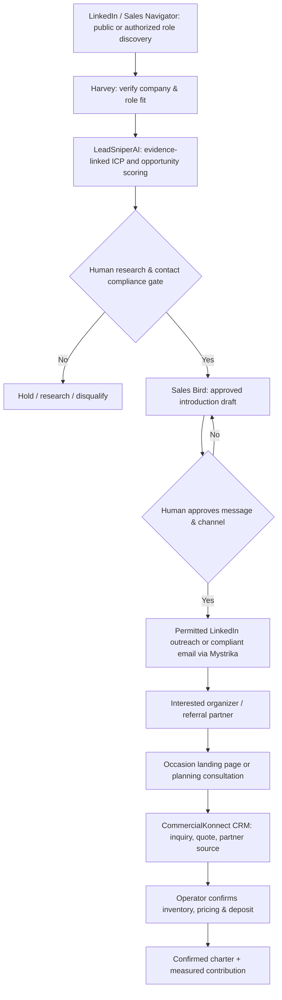

# LinkedIn B2B & Partnership Intelligence — Ocean Wave VIP

**Status:** Research and go-to-market operating specification (not deployed or activated).  
**Target market:** Metro Vancouver, British Columbia.  
**Objective:** Generate qualified consultations, private-charter quotes, event-planner referral relationships, and **confirmed profitable charter bookings**.

> **Evidence boundary:** The segments, search filters, message examples, scoring rubric, and pilot volumes are proposed strategies, not a database of verified people or actual LinkedIn group results. No profiles were scraped, contacts harvested, accounts messaged, or campaigns launched. This repository is public; never commit personal profile/contact information or client-confidential records.

## 1. Positioning and channel role

**LinkedIn = professional buyer / referrer discovery** for private corporate celebrations, executive retirement, employee recognition, leadership team experiences, client entertainment, and event-planning referrals.  
**Meta = consumer celebration inspiration** for birthdays, brides, stag/stagette, girls'/guys' outings and new beginnings.  
**Google = high-intent charter and occasion search**.

Primary brand proposition for testing: **“Make your next private celebration memorable on Vancouver's waterfront.”** Do not assert verified fleet availability, charter guest capacity, amenities, price or weather commitments until Ocean Wave's operator approves the facts.

### Commercial offers to validate with Ocean Wave
| Offer concept | Primary buyer | CTA | Operator verification required |
|---|---|---|---|
| Executive retirement cruise | HR / executive assistant | Request a private event proposal | Vessel fit, rates, event logistics |
| Employee appreciation charter | People & Culture / office manager | Book a planning consultation | Minimums and company booking terms |
| VIP client entertainment | Partner / founder / account director | Check dates and get a quote | Business hosting inclusions |
| Corporate networking event | Association event manager | Discuss private-group options | Licensed capacity, itinerary |
| Wedding-vendor partner program | Planner / photographer / coordinator | Explore referral partnership | Referral terms, permitted add-ons |
| Hotel concierge referral offer | Concierge / guest services manager | Request partner information | Availability/response SLA |

## 2. Ideal customer profiles (ICPs) and search workflows

### Search territory
Vancouver, Burnaby, Richmond, North Vancouver, West Vancouver, New Westminster, Surrey and nearby Metro Vancouver. Adjust radius according to actual boarding location, travel patterns, and inbound customer evidence.

### Professional role clusters
| Priority | ICP | LinkedIn title/company search strings | Qualification questions |
|---|---|---|---|
| P1 | Corporate event buyer | `"Event Manager" OR "Event Planner" OR "Director of Events"` | Does this person source intimate local group events? |
| P1 | HR / employee recognition | `"HR Manager" OR "People and Culture" OR "Employee Experience"` | Do they organize retirement, team or recognition gatherings? |
| P1 | Executive/office administration | `"Executive Assistant" OR "Office Manager" OR "Workplace Experience"` | Are they involved in booking leadership or staff events? |
| P1 | Wedding planners | `"Wedding Planner" OR "Wedding Coordinator"` | Do they arrange pre-wedding or private group experiences? |
| P2 | Hotel/concierge | `"Concierge Manager" OR "Guest Experience" OR "Hotel Events"` | Can they introduce appropriate guests through approved partnerships? |
| P2 | Professional associations | `"Membership Director" OR "Events Coordinator"` | Is there a legitimate member event or networking fit? |
| P2 | Company founders/partners | `"Founder" OR "Managing Partner" OR "President"` | Evidence of a genuine event need; do not assume from title |

Apply city, industry, organization, seniority and relevant experience filters in LinkedIn or Sales Navigator where legitimately available. *Search suggestions are not actual verified candidate records.*

### Business segmentation
Start with professional services firms, corporate office teams, accounting/law practices, technology companies, real estate organizations, wedding vendors, and hospitality. Prioritize event fit and documented occasion signals over company size or assumed wealth. No targeting based on relationship status or sensitive private life events.

## 3. LeadSniperAI / Harvey / Sales Bird workflow

**Tools and limits:**
- **Harvey / LeadSniperAI:** company identity, verified professional role and publicly evidenced relevance, no guessed decision-makers.
- **Sales Bird / Hermes:** research briefs, recommended next steps, ICM approval checkpoints, human-reviewed introductions; no automated bulk LinkedIn messages or scraping outside platform rules.
- **Mystrika:** separate cold-email channel only if the recipient, message, consent/exemption basis, identification and unsubscribe requirements comply with Canadian CASL and applicable privacy law. A public LinkedIn profile is **not consent**.
- **Supabase / CommercialKonnect CRM:** organization, opportunity, source, appointment and outcome; restrict access to non-public prospect data.
- **Cal.com:** consultation appointment scheduling only, NOT yacht inventory.
- **Resend / Twilio:** consent-aware communication after genuine inquiries or bookings, not blanket outreach to discovered profiles.

## 4. Fit qualification (proposed 0–100 rubric)

| Criterion | Weight | Evidence |
|---|---:|---|
| Documented event-organizing responsibility | 25 | Official job description, company event remit, verified partner role |
| Matching event and group-size fit | 20 | Company occasion demand / requested event / relevant vendor service |
| Metro Vancouver geographic fit | 15 | Documented business operations within charter travel area |
| Potential for repeat referrals or events | 15 | Event-planning profession / regularly staged events |
| Decision authority or verified buyer access | 15 | Job role verified; avoid guesses |
| Evidence quality and compliant contact route | 10 | Dated URLs and legal contact basis |
| **Total** | **100** | |

**Gate to Qualified:** confirmed business identity, relevant service geography, documented event fit, plausible buyer or partner role, a suitable operator-approvable offer and a lawful contact path. Otherwise retain `Research`/`Hold`. Score is prioritization, not conversion probability.

## 5. Campaign playbooks

### A. Executive retirement
**P.S.S.O.**
- Problem: arrange a distinctive, intimate retirement recognition event without complicated venue coordination.
- Stats: obtain first-party evidence or client-approved quote metrics; *no unsupported claims that yacht events outperform restaurants*.
- Solution: private group charter with transparent owner-approved vessel/rate/terms and guided planning.
- Offer: **“Request a private executive retirement celebration proposal.”**

### B. Employee appreciation
Content: short leadership/HR-friendly planning checklist covering guest size, date, boarding accessibility, charter policies and weather contingencies. CTA: **“Discuss private employee celebration options.”**

### C. Wedding planner partnerships
Research established planners, photographers and decorators. Propose client-approved joint offer options, introduce through permitted professional channels and document referral terms. CTA: **“Explore a private-charter referral partnership.”**

### D. Concierge / hospitality
Partner one-pager should include actual boarding point, charter minimum, client contacts, group capacity and service constraints only after verification. CTA: **“Request charter partner details.”**

### E. Association and client hosting
Position a smaller private charter as an experience for suitable leadership, professional or member groups. CTA: **“Check dates for a private group event.”**

## 6. Messaging drafts (human approval required)

**Professional connection introduction — event planner**
> Hello, I work with a Vancouver private-charter concept focused on small-group celebrations and corporate experiences. I noticed your professional focus on event planning. Would it be relevant to share a brief overview for potential future client events?

**HR / executive assistant**
> Hello, I'm researching ways Vancouver organizations recognize retirement milestones and host small private team events. We have a proposed private waterfront celebration experience. Would a short event-planning overview be useful?

**Wedding partner**
> Hi, I noticed your work in wedding planning. We're developing an option for private pre-wedding yacht celebrations in Vancouver. Would you be open to reviewing the concept as a potential referral partner?

Do not claim an existing Ocean Wave affiliation, partnership, operational capability or approved offer that has not been authorized. Adapt messages to the verified company and professional remit; do not automatically send or use misleading personalization.

## 7. Appointment conversion and partner source attribution

**LinkedIn referral / approved conversation → tracked corporate/partner landing page → quote request OR free 15-minute planning consultation (if approved) → vessel fit / real availability verified → personalized quote → deposit-confirmed charter.**

Suggested URL concept: `/corporate-private-yacht-events-vancouver/` or `/event-planner-partners/` after checking existing live site architecture and duplicate search intent.

Track source, campaign, partner identifier, role/organization verification, consent/legal basis, date, occasion, party size, approximate budget (optional), lead status, consultation, quote, deposit-confirmed booking, actual revenue and contribution. Do not store unnecessary personal profile details in the public repo.

Proposed CRM partner stages: `Research → Identity Verified → Opportunity Qualified → Outreach Approved → Introduction Sent → Interested → Partner Discussion → Approved Partner → Referral Received → Quote → Confirmed Charter`. Keep event inquiries separate from partner relationship status.

## 8. 30-day pilot (targets, not predictions)

| Period | Work | Planned deliverable |
|---|---|---|
| Days 1–7 | Research 50 Metro Vancouver organizations and verify role/occasion fit | 30 candidate decision-makers or partner contacts |
| Days 8–14 | Prepare personalized, evidence-supported partnership proposals | Up to 20 human-approved introductions |
| Days 15–21 | Monitor interest and schedule permitted planning/partner meetings | Target 5–8 qualified conversations; 3–5 meetings |
| Days 22–30 | Review partner feedback, quote and deposit conversion | Target 1–2 promising referral relationships; bookings tracked |

Targets require realistic staff effort and client operating approval. **No lead counts or outcomes above are verified historical results.**

## 9. Measurement

Leading: verified relevant professionals, approved introductions, delivered messages (only where lawful), replies, partner conversations, consultation show rate.  
Commercial: referred inquiries, quote rate, deposit-paid charters, charter revenue, realized contribution after partner fees/acquisition costs, repeat partner bookings.

Segment results by executive retirement, employee recognition, client hosting, wedding referrals and concierge introductions. Optimize for profitable confirmed charters rather than connection count.

## 10. Compliance & approval gates

- Do not circumvent LinkedIn access restrictions, scrape logged-in or private groups, mass-message connection lists, or infer sensitive characteristics.
- Human approval before prospect outreach, campaign publication, client-brand usage, referral deal or spending money.
- CASL/privacy review for electronic marketing. Document intended recipients' consent or applicable legal basis; include business identification and unsubscribe when required.
- No false relationships, stock imagery posed as actual Ocean Wave vessels, fabricated endorsements, asserted rates or unverified guest capacities.
- No yacht reservation is confirmed from a Cal.com consultation booking; only the owner/authorized operator verifies inventory and booking terms.
- Run the pilot only after Ocean Wave confirms brand authorization, current fleet facts, operating contact and event offers.

## 11. Relationship to existing Partyatch wiki

- [Audience/community LeadOS strategy](LEADOS_AUDIENCE_GROUPS.md) (may still be pending merge)
- [Social campaign matrix](SOCIAL_CAMPAIGNS.md)
- [Appointment funnel](GTM_FUNNEL.md)
- [Content Bible](CONTENT_BIBLE.md)
- [Client brief and verification ledger](CLIENT_BRIEF.md)
- [Market intelligence roadmap](INTELLIGENCE_AND_ROADMAP.md)

**Status summary:** Research and implementation directions only. No LinkedIn accounts, Sales Navigator data, CRM entries, campaigns, emails or appointments have been created by this document.
