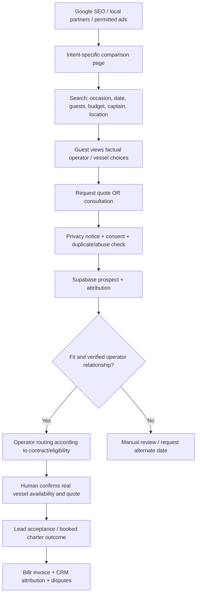

# Proposal — Vancouver Yacht & Boat Rank-and-Rent Directory

**Status:** Draft / decision proposal, not a launched marketplace. **Prepared:** 2026-11-11. **Sponsor:** KlickSmartAI; proposed founding operator: Ocean Wave VIP (participation and approvals not established). **Target market:** Vancouver / Metro Vancouver, British Columbia, Canada. **Commercial model:** independent charter comparison and qualified-lead generation.

## 1. Executive decision

Build a **mobile-first, independent, locally focused charter-comparison directory** that helps prospective guests find suitable **captained private yachts, smaller boat rentals, and party/event boats** and request an accurate quote. Monetize accepted, qualified booking enquiries and operator category-rental agreements; test booking commissions only with explicitly authorized attribution and settlement terms.

**Stage-gated recommendation:** approve a narrow research + supply-validation MVP, **not** a broad SEO page factory. Launch an indexable marketplace only after at least 3 independent participating operators, 10 verified eligible vessels or truly differentiated offerings, reliable lead handling, and privacy/contract approvals. An operator might offer multiple vessels; never represent unverified fleet capacity as bookable. Ocean Wave is proposed as the first partner, not the owner of all marketplace listings or an automatically preferred result.

This initiative is **separate** from the Ocean Wave branded GTM funnel: own domain, disclosure of sponsorships, clear operator identity, and no implication of endorsement by other operators without consent.

### Value proposition
- **Guest:** compare charter type, guest limit, captained/self-drive status, credible total costs, departure points, amenities and cancellation policies; avoid submitting multiple incomplete quote requests.
- **Operator:** accepted, date-specific, event-qualified leads; eligibility/routing controls, lead rejection disputes, optional exclusive channel, attributable confirmed bookings.
- **KlickSmartAI:** a reusable local vertical demand asset with operator retainers, paid leads and referral revenue, reusing Astro Website Factory, LeadSniperAI, Harvey, Hermes, OpenSEO, Supabase, CRM and Billr.

## 2. Source inventory and evidence limitations

| Source | Observed evidence | Important limitation |
|---|---|---|
| [Ocean Wave keyword library](KEYWORDS.md) | 10 high-priority transactional keyword rows; reported volume/CPC/competition | Provider, CPC currency, targeting, timeframe, and match-type unknown. Variant volumes overlap. |
| [SeaSky keyword-gap PR #2](https://github.com/Ksdeng1559/partyatch-GTM/pull/2) | Historical export ranks: SeaSky yacht rental Vancouver #5, boat rental Vancouver #6; occasion-specific birthday page with reported 26 ranking keywords and estimated traffic 14 | PR source snapshot, not a fresh Google SERP; export not merged to `main`; no Ocean Wave ranking proof. |
| [Website Factory SERP PR #8](https://github.com/Ksdeng1559/klicksmartwebsiteFactory/pull/8) | 98-row rank/title/URL/domain export and 11-row opportunity matrix | Google redirect URLs, unknown originating queries, unresolved canonical domains; not a per-keyword complete SERP dataset; PR not assumed merged. |
| [Localo prospecting Notion database](https://app.notion.com/p/d03e8b2975c948a2be65bb1d4e87fd10) | 43 Localo rows categorized `Yacht Charter` or `Boat Rental & Tours`, 41 with website URLs (queried 2026-11-11) | Source categories and sites **unverified**, names are business records not verified individual owners, no partner/marketing consent. Some rows are brokers, tour firms, duplicates or unrelated. |
| [OpenSEO research issue #5](https://github.com/Ksdeng1559/partyatch-GTM/issues/5) | Scope for actual Vancouver-localized top-20 SERPs, competitor matrix and KD | Issue open at writing; live OpenSEO run/cost approval not established. |

**Do not sum keyword variants into a TAM, claim real-time rankings, claim published/verified operator inventories, or infer booking availability from consultation calendars.** 

## 3. Reorganized customer-facing directory taxonomy

The main navigation is **commercial purchase mode**; experiences, locations, boat types and operators are filters/secondary collections, *not* parallel near-identical pages.

| Primary category | Buyer intent | Eligible examples | Monetization suitability |
|---|---|---|---|
| **Yacht Charters** | Exclusive, typically captained yacht for a private group | Motor yacht, luxury yacht, captained catamaran, private sailing charter (after verification) | High-intent qualified lead; limited exclusive category rights; approved referral commission |
| **Boat Rentals** | Smaller recreational watercraft or modest-group rentals | Self-drive rental, captained small boat, pontoon where licensed/operated | Lower-value qualified leads; placement/listing; clear self-drive vs captained distinction |
| **Party & Event Boats** | Group occasion, private hospitality and event logistics | Birthday, bachelorette, corporate party, wedding/event vessel | Occasion-qualified lead; corporate RFP; private booking commissions |
| **Boat Tours & Experiences** (phase 2) | Tour ticket, shared cruise or sightseeing; may not be private charter | Harbour tours, sunset, wildlife, kayaking/paddling | Legitimate affiliate ticket/featured listing model where permitted, **not** private charter routing |
| **Marine Partners** (supporting, not a prime SEO money page) | Slip, marina, membership, broker, repair, yacht sales | Marina, yacht club, yacht-sales brokerage | Sponsorship, referrals and ecosystem; avoid listing as charter operator |

**Facets** (no indexable duplicates by default): captain included, vessel type, licensed guest limit, budget band, minimum hours, weather policy, departure area, accessibility and amenities, event suitability, verified availability status.

**Operator ≠ vessel ≠ experience ≠ landing page**: one canonical operator profile can have many verified vessels, each eligible for multiple experiences. Do not auto-create duplicated city/keyword doorway pages.

## 4. Search-demand clusters and canonical page map

**Numbers below are tool-reported export values, neither validated Vancouver-monthly demand nor additive.** Existing documentation is the basis; OpenSEO must validate distinct intent, rankings and keyword difficulty before final indexation.

| Cluster | Baseline keyword(s) with supplied volume | Proposed canonical page | Phase | Editorial requirement |
|---|---|---|---|---|
| Yacht rentals | yacht rental vancouver **1,900**; rent a yacht in vancouver **1,900**; yacht hire vancouver **880** | `/yacht-rentals/vancouver/` | P0 | Unique multi-operator list, yacht criteria, honest verified starting costs |
| Boat rentals | boat rental vancouver **1,900** | `/boat-rentals/vancouver/` | P0 | Captained vs self-drive differentiation, safety/licensing details |
| Private charters | charter a boat in vancouver **880**; boat charter vancouver **170** | Consolidate initially within yacht/boat category; `/private-charters/vancouver/` **only if SERP distinct** | P0 conditional | No cannibalization between yacht hire and private charter synonyms |
| Private celebrations | boat rental for party **260** (not geo-qualified); boat party rental vancouver **140**; vancouver yacht rental party **90** | `/party-boats/vancouver/` | P0 | Real category inventory, occasion and capacity filtering |
| Birthday parties | birthday yacht rental Vancouver **unmeasured** | `/experiences/birthday-boat-parties/` | P1 | Party planning FAQ, capacity, minimum charter durations; specific vessel examples |
| Stag / stagette | bachelor/bachelorette yacht Vancouver **unmeasured** | Occasion hub initially; standalone page after distinct-intent validation | P1 conditional | Different buyer needs, distinct content and packages |
| Corporate events | corporate yacht charter Vancouver **unmeasured** | `/experiences/corporate-yacht-events/` | P1 | Group logistics, event brief/RFP, proposal and invoicing |
| Harbour cruises & tours | boat tour vancouver **720** (may refer to sightseeing) | `/boat-tours/vancouver/` | P2 | Separate ticketed-tour path, not bundled into charter totals |
| Price research | yacht rental Vancouver prices **unmeasured** | `/guides/yacht-charter-cost-vancouver/` | P1 | Transparent cost components using dated operator-approved rates; label illustrations |
| Marina/departure areas | Coal Harbour / Granville Island / Indian Arm / Bowen Island **unmeasured** | `/locations/[verified-departure]/` or `/destinations/[verified-trip]/` | P2 conditional | Actual departures/itineraries and practical local value, not auto-generated location swaps |

**Suggested MVP 8–12 useful pages:** home, 3 P0 category pages, verified operator directory, 2–3 experience/comparison pages where supported, pricing guide, one demonstrated location guide, enquiry form/privacy/terms. Defer indexation of empty filters, thin profiles, and unsupported categories. Indexable operator/vessel pages become viable as sufficient verified unique content exists.

### Technical SEO acceptance
One primary intent per canonical URL; semantic internal navigation; readable server-rendered Astro HTML; local factual content; `Organization`, `BreadcrumbList` and appropriate `ItemList`/eligible structured data only when factual; no fake review aggregates; `noindex` for user-search/filter variants and drafts; sitemaps and GSC verification; Core Web Vitals; clear independence and advertising disclosure.

## 5. Localo operator seed inventory — **candidate classifications only**

The names and website URLs below were **read from the existing Notion Localo dataset**. Classifications are preliminary, **not** proof of vessel ownership, listing rights or charter availability. Verify official website, operator identity, eligible fleet, service area, guest limits and consent before publication. This is a selection, not a complete 43-row export.

| Seed business | Localo-listed website | Proposed segment / action |
|---|---|---|
| Ocean Wave Yacht Charter | https://www.oceanwavevip.com/ | Potential anchor private charter; obtain explicit marketplace and data permission |
| SeaSky Cruises | https://www.seaskyboatrental.com/ | Multi-category yacht/boat operator; verify each eligible listing and terms |
| Vancouver Yachts Charters | https://www.vancouveryachts.ca/ | Private yachts; confirm vessels and prices |
| Turn Yacht Charter Services Inc. | https://www.turncharter.ca/ | Private / event yacht; verify event capacity |
| Vancouver Yacht Life | https://vancouveryachtlife.com/ | Private charter; verify fleet and operating policies |
| Watercraft Charters | https://www.watercraftcharters.com/ | Private yachts; verify direct-operator relationship |
| Vancouver Yacht Charters | https://www.vancouveryachtcharters.com/ | Private charter or event fleet; distinguish similarly named entities |
| Magic Yacht Charters | http://www.magicyachtcharters.com/ | Large event boat; verify fleet |
| Pacific Yacht Charters | http://www.pacificyachtcharters.com/ | Premium corporate/event boat |
| Yoho Cruises | http://www.yohocruises.com/ | Event / cruise operator, confirm private vs shared |
| Vancity Cruises | https://vancitycruises.com/ | Cruises and events; verify charter fit |
| Mirage Cruises | https://www.miragecruises.ca/ | Cruise / event vessel, verify private bookings |
| Vancouver Water Adventures | https://vancouverwateradventures.com/ | Boat tours / recreational rental (phase 2) |
| Deep Cove Kayak Centre | http://www.deepcovekayak.com/ | Paddlesports (phase 2), not luxury charter |
| Deer Lake Boat Rentals | https://deerlakeboatrentals.com/ | Recreational boating (phase 2), not yacht charter |
| Renthese Boat Rentals | http://boat.renthese.com/ | Potential booking intermediary; deduplicate related Localo brands |
| Vancoventure Boat Charters Inc. | *Not provided in Localo export* | Website and active charter service require verification |
| Whale Tales Yacht Charters | *Not provided in Localo export* | Website and charter service require verification |

**Do not treat marinas, yacht clubs, yacht-sales brokers, fishing providers or shared kayak operators as equivalent paying charter inventory.** Example separate supporting partners: Mosquito Creek Marina, Reed Point Marina, Freedom Boat Club and local yacht clubs; all require independent product-fit evaluation.

### Operator approval / publish gate
For each operator, record `legal_name`, `business_site`, `source_url`, `verification_date`, `operator_type`, `listing_permission`, `licensed_capacity_evidence`, `insurance_and_operating_confirmation`, `image_rights`, `service_area`, `fees_and_terms_last_confirmed`, `partner_contract_status`. Mark `candidate` until confirmed. Verified business listings may be factual public directory entries, but copyrighted photos, private rates, booking integrations and exclusive representations require appropriate rights/agreements.

## 6. Lead acquisition, matching and operator handoff

**BANT adapted to events:** Budget (optional until conversion), Authority (actual organizer), Need (occasion, vessel/guest requirements), Timeline (target/alternative date), and vessel safety/availability. A *billable accepted qualified lead* requires real contact details, an appropriate consent basis for lead sharing, service-area and vessel eligibility, a concrete event date or purchase horizon, and not previously sold/duplicate within the contractual lookback. Explicitly define unavailable capacity, spam, stale, duplicate, wrong budget/area and cancelled buyer as rejection cases.

**Booking integrity:** Cal.com slots are consultation appointments only; they are not live inventory. Avoid claims of a confirmed yacht until the named operator checks availability and applies its deposit and cancellation policies. The marketplace must not process operator deposits without authority and payment/chargeback controls.

## 7. Monetization and test economics (CAD)

These amounts are **pricing hypotheses for operator discovery interviews**, not verified rate-card benchmarks:

| Product | Test price | Charging rule |
|---|---:|---|
| Shared / nonexclusive accepted lead | **$50–$100 / lead** | Up to a disclosed small number of nonexclusive participants |
| Exclusive high-intent lead | **$100–$175 / lead** | Only one operator, with qualification and rejection SLA |
| Category/area lead rental | **$499–$1,499 / month** | Defined opportunity rights and minimum delivery/service terms; rights cannot conflict |
| Sponsored enhanced operator profile | **$99–$249 / month** | Clearly labelled promotion, not implied organic quality rank |
| Confirmed-booking referral | **5%–10% of eligible booking revenue** | Signed contract, auditable attribution, refunds/partial cancellations addressed |

**No double billing:** a lead assigned under an inclusive exclusivity/rental plan must not also be sold per lead; referral and per-lead fees may not stack for the same booking unless expressly negotiated. Sponsored results must be disclosed and organic comparison rankings remain independent.

Illustrative **active-season gross revenue scenarios**, with separate billable lead stock and rental-plan entitlements:

| Assumptions | Conservative | Base | Growth |
|---|---:|---:|---:|
| Accepted, individually billable leads per month | 10 | 30 | 60 |
| Average fee | $75 | $100 | $125 |
| Additional operator retainers (leads not double-billed) | $0 | 2 × $500 | 3 × $750 |
| **Gross/month before all costs** | **$750** | **$4,000** | **$9,750** |

These are **target scenarios, not traffic or booking forecasts**. Validate click-through, seasonality, organic rank, enquiry conversion, lead acceptance and sales cycle before using as budget. Record separate one-off setup costs, advertising spend, people/time, tool fees, refunds, tax, and operator support. Vancouver charter seasonality makes annualizing a summer run-rate misleading.

### Pilot commercial gates
- 3+ signed operator participation agreements with verified vessels/services and a workable fulfillment SLA.
- 10+ approved vessels/offers with enough diversity for meaningful comparison, or limit site to a transparent lead-matching service rather than a misleading marketplace.
- Pilot acceptance rate target **≥70%** of leads that pass published qualification criteria, verified during a minimum sample of 20 leads (proposed threshold, not observed).
- Initial *unit economics* test: positive gross profit after lead acquisition, fulfillment, support, refunds and payment processing; a separate target payback period for any paid channel.
- 0 unapproved pricing, fake reviews, fake availability or unconsented lead transfers.

## 8. Technical architecture and data model

**Astro Website Factory** (SSG/SSR where appropriate) → **Supabase** multi-tenant system of record → CommercialKonnect CRM for partner/customer stages → **Billr/Stripe** for contractual invoices → Resend/Twilio for approved transactional notifications → **OpenSEO** for SERP/keyword monitoring, **LeadSniperAI / Harvey** for research/enrichment and **Hermes** for human-gated monitoring.

Core tables (proposed, not deployed): `operators`, `operator_verifications`, `vessels`, `vessel_media_rights`, `vessel_experiences`, `locations`, `experience_types`, `directory_pages`, `keyword_clusters`, `serp_snapshots`, `inquiries`, `consent_events`, `lead_matches`, `lead_assignments`, `lead_acceptances`, `charter_quotes`, `booking_attributions`, `operator_contracts`, `billing_events`, `audit_log`.

Implementation rules:
1. Deduplicate prospects by normalized site + Google Place ID / legal entity, but preserve aliases and chain locations.
2. Keep business-level public facts apart from person-level verified contact data. Use privacy notice, CASL-compliant communications and appropriate contractual operator data sharing.
3. Enforce Supabase tenant scoped RLS; never store third-party credentials or quote approval secrets in client bundles.
4. Unique idempotency keys on inquiry, routing, payments and external webhooks; build lead acceptance/rejection workflow with immutable event history.
5. Collect UTM, referring landing page, actual click IDs only with appropriate consent; store provenance and metric timestamps.
6. Operator self-service listing review/claim and human approval gate; `published_at` only after verification and content rights check.
7. Firecrawl/other enrichment permitted only subject to site terms and rights; no unauthorized private membership scraping.

## 9. Phased implementation and acceptance

| Gate | Timebox estimate | Output | Go/no-go check |
|---|---|---|---|
| **0. Research** | Days 1–10 | Reconcile Website Factory PR #8, SeaSky PR #2 and Keyword library; run approved OpenSEO requests per [issue #5](https://github.com/Ksdeng1559/partyatch-GTM/issues/5) | Actual per-query SERP, KD and geography; identify which intent clusters support distinct pages |
| **1. Supply/partnerships** | Days 11–20 | Validate 15–20 operator candidates; seek permission; record 3+ signed participants and 10 eligible offers | Credible directory inventory & lead delivery contract |
| **2. MVP build** | Days 21–35 | Astro categories, operator/vessel profiles, comparison filters, consented quote form, Supabase/CRM routing | End-to-end synthetic lead and billing tests, data protection |
| **3. Commercial pilot** | Days 36–45 | Lead rejection/SLA policy; paid pilot agreements; price test with founding partners | Commercial clarity and actual capacity response |
| **4. Public launch/learning** | Days 46–60 | Approved site/indexation, GSC, legitimate promotion, conversion tracking | Measurable accepted leads, response performance, sustainable contribution margin |

**Timing is a development planning estimate, not a promise of organic ranking or lead volume.** SEO may require months and seasonal cycles to prove yield.

## 10. Governance and explicit open decisions

- **Brand/domain**: independent descriptive name; check trademark/domain availability before commitment.
- **Ocean Wave arrangement**: independently negotiated founding partner / preferred referral rights if suitable; sponsored ranking disclosed, no false exclusivity.
- **Operator onboarding and content**: public factual entries vs claimable/opted-in listings, media permissions, customer review verification, price verification cadence.
- **Lead exclusivity**: define geography, events, deal sizes, caps, operator fallback and termination.
- **Compliance**: privacy, CASL, marketing consent, GST/PST applicability, sales tax and possible travel/charter regulatory obligations; obtain professional confirmation before booking/payment launch.
- **Source quality**: Notion Localo prospective names are not verified charter partners; OpenSEO research remains pending execution.
- **Build responsibility**: Claude Code develops initial Astro/Supabase prototype via reviewed PR; Hermes monitors later only under separate approved task and cost gate.

### Approval checklist
- [ ] Confirm primary business model and independent directory branding.
- [ ] Validate keyword page hierarchy via per-keyword SERPs / SEO intent overlap.
- [ ] Validate operator coverage, licenses, photos, pricing and partner consent.
- [ ] Approve qualified-lead definition, routing SLA, exclusivity and dispute policy.
- [ ] Approve secure privacy/terms and contract templates.
- [ ] Prototype main search/quote flow before public lead capture.
- [ ] Perform content/legal/technical quality review and decide go/no-go.

**References:** [Keyword map](KEYWORDS.md) · [Ocean Wave funnel](GTM_FUNNEL.md) · [OpenSEO issue #5](https://github.com/Ksdeng1559/partyatch-GTM/issues/5) · [Website Factory SERP PR #8](https://github.com/Ksdeng1559/klicksmartwebsiteFactory/pull/8) · [SeaSky gap PR #2](https://github.com/Ksdeng1559/partyatch-GTM/pull/2) · [Localo Notion prospect database](https://app.notion.com/p/d03e8b2975c948a2be65bb1d4e87fd10)
