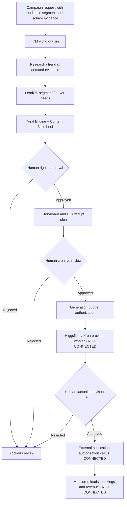

# Ocean Wave VIP — ICM Content-to-Lead Orchestrator

**State:** runnable Node.js **local dry-run** with auditable stage transitions. This is not a live agent backend or a deployed Supabase system. The ICM state machine lives under `icm/src/engine.mjs`, with a single-writer file demo store, CLI and Node test suite.

## Intent and separation of responsibilities

ICM serves as the central coordination contract for the **Ocean Wave VIP Content Factory** while preserving the GTM distinction between attention, charter inquiries, consultation appointments, actual vessel availability, human-approved quotes and operator-confirmed charter bookings.

The system is based on the project's existing [Content Bible](../docs/clients/ocean-wave-vip/CONTENT_BIBLE.md), [Social Campaigns](../docs/clients/ocean-wave-vip/SOCIAL_CAMPAIGNS.md), [GTM Funnel](../docs/clients/ocean-wave-vip/GTM_FUNNEL.md), [Notion Content Factory](https://app.notion.com/p/4159e94cf0a481619c66cb0542cfb5e9) and [KlickSmartAI VideoAd Social UGC factory draft PR #3](https://github.com/Ksdeng1559/Klicksmartai.VideoAd.Agent/pull/3).

### Architecture



**Stage DAG:** `research → segmentation → brief → rights → storyboard → creative_review → generation → quality_review → publishing → measurement`.

**Human-owned approval gates** are `rights`, `creative_review` and `quality_review`. `publishing` uses a **separately recorded written authorization reference** and an existing platform publication URL. Calling `recordPublication` **does not publish** anything.

### Runtime capabilities implemented

- Creates versioned workflow runs with an immutable campaign/segment/format/platform identity and source references.
- Derives ready work from a fixed dependency DAG; blocks out-of-order stages and tracks human approval decisions with evidence references.
- Explicitly separates `work`, `approval` and `external` operations; an ordinary agent cannot start an approval or publish step.
- Uses optimistic `expectedVersion` checks for individual transitions, with an append-only *in-memory* event sequence captured in each saved snapshot.
- Requires an evidence URI when completing a work stage and approval evidence on human review.
- Enforces integer CAD-cent budget cap and reservations before allowing paid generation; actual cost cannot exceed reserved estimate.
- Releases unused reservations on paid step completion/failure/cancellation; allows up to three attempts before intervention.
- Records failed, rejected and cancelled states. Rejected approvals require explicit intervention/new workflow; they are not silently bypassed.
- Ships a single-writer filesystem adapter, CLI and dependency-free Node.js tests.

**Not implemented:** live trend retrieval, real LeadOS/viral API calls, Higgsfield/Krea generation, binary asset storage, external webhooks, production queue, supplier authentication, multi-process locking, billing, publishing, scheduler, DMs, social metrics, end-to-end CRM, quote booking flow or production SQL transaction functions.


## Offline handoff from the Social & UGC Content Factory (implemented)

The [VideoAd Agent Social / UGC Factory draft PR #3](https://github.com/Ksdeng1559/Klicksmartai.VideoAd.Agent/pull/3) now has an **Export to ICM (offline)** button. It creates a portable JSON file using the strict `klicksmartai.oceanwave.icm-handoff.v1` contract, including audience, channel, format, topic, hook, working script, storyboards, CTA, lead magnet and original Notion Content Bible references. It includes no audience/customer PII, API key, source footage or permission to spend or publish.

Local handoff instructions:

1. In the VideoAd Agent, open **Social / UGC Factory**, select a pilot idea, segment, format and platform, then click **Export to ICM (offline)**.
2. Save the generated file locally and open a terminal in this repository's `icm/` directory.
3. Run:

```bash
node src/cli.mjs import-creative --file=/absolute/path/to/owvip-romance-microdrama-a-icm-handoff.json --actor=producer
```

The importer validates schema version, campaign identifier, creative/ICM metadata agreement, known segments/formats/platforms, trusted-source URL shape, **zero starting budget**, and explicit false approval/publishing/payment flags. Invalid packages are rejected. Successful imports create a new single-writer local run, retain the working creative as an **unreviewed brief seed**, and start with **research ready**, not an implicitly approved brief. Rights, creative and quality approvals are still mandatory. The `createdBy` actor is self-declared in this local demo, not authenticated.

```bash
node src/cli.mjs status --id=<returned-run-uuid>
node src/cli.mjs start --id=<returned-run-uuid> --stage=research --actor=researcher
node src/cli.mjs complete --id=<returned-run-uuid> --stage=research --actor=researcher --receipt=test://dated-research
```

The intake is a **file exchange**, not a running inter-repository API or Supabase service. Duplicate file imports create separate demo runs; production must implement durable idempotency, matching campaign identity and atomic insertion. The CLI accepts only a planning document. It never calls Higgsfield, Krea, a social network or an operator payment endpoint.

## Local demo

Requires Node.js 20+; no npm install or credentials needed for the engine.

```bash
cd icm
npm test
node src/cli.mjs init --campaign=owvip-romance-pilot --segment=romance --format=microdrama --platform=instagram --budget=5000 --actor=producer
```

Copy the returned run UUID and issue commands with `--id=UUID`:

```bash
node src/cli.mjs status --id=UUID
node src/cli.mjs start --id=UUID --stage=research --actor=research-agent
node src/cli.mjs complete --id=UUID --stage=research --actor=research-agent --receipt=test://research-report
```

Continue `segmentation`, `brief`, then:

```bash
node src/cli.mjs approve --id=UUID --stage=rights --actor=authorized-human --role=client_approver --decision=approved --evidence=test://rights-approval
```

Then `storyboard`, `creative_review` approval, and only after signed authorization: `generation` start with an explicit `--estimate=... ` (CAD cents), completion with `--actual=...`, `quality_review` approval, and `record-publication` with `--authorization=...` and a verified `--url=https://...`. These commands only record operator-submitted evidence and are **not production proof of an authentic decision or a successful paid render**.

Local state is saved under `.icm-local-runs/` and ignored by Git. Do not put lead PII, private footage links, customer contact details, tokens, or contract secrets into the CLI or receipts. Single writer only; do not use this file store in a hosted multi-instance app.

## Production backend proposal

`db/migrations/20261111_icm_content_factory.sql` provides a **reference**, not an applied migration, for `icm_campaign_runs`, `icm_stage_runs`, `icm_approval_decisions`, `icm_event_log` and `icm_idempotency_receipts`. Supabase RLS is enabled with **no anonymous or authenticated-user table access**. A reviewed server-only service-role worker plus properly authenticated tenant authorization is required.

Before enabling production:
1. Validate SQL migration on an isolated Supabase staging database; do not deploy against live tables before review. A named static migration may require adaptation for existing schemas.
2. Implement server-side tenant identity/role checks and atomic transition RPC using `SELECT ... FOR UPDATE`, monotonic revision check and stage+budget+event commit in one transaction.
3. Verify idempotency key uniqueness and durable queue outbox + worker lease with at-least-once delivery/reconciliation. Use provider job IDs, content hashes and callback signatures for retry safety.
4. Implement scoped server-side provider adapters: LeadOS and Viral Engine research intake, Higgsfield/Krea model/catalog/cost discovery, approved job submission, status polling and result QA.
5. Route **final approval** through actual user identity, not a CLI-supplied role string. Store approval evidence and rights lineage in approved private storage; no secret payloads in event log.
6. Require documented client-signed editorial/factual approval, usage rights, production budget and publishing authority. Publishing must be paused by default and reversible where supported.
7. Connect landing-page attribution, inquiry consent and CommercialKonnect/Atomic CRM with approved connectors; do not treat Cal.com consultation times as vessel availability.
8. Record social performance and actual qualified leads/bookings/revenue only after verified provider results; run one-variable hook tests instead of assuming virality.

## Delivery gates

| Domain | State in this PR | Real-world verification required |
| --- | --- | --- |
| State machine, dependency order, evidence receipts | Implemented in JS | Node tests / browser integration |
| Role references and human approvals | Simulated via trusted caller inputs | Supabase authenticated roles, legal approval evidence |
| Provider budgets | Local reservation invariant | Real pricing, budget approval, actual invoice reconciliation |
| Durable local persistence | Single-process, demo only | Database transaction and retry consistency |
| Multi-tenant Supabase persistence | Reference migration only | Migration, secure functions, RLS access review |
| Higgsfield/Krea rendering, social publishing | Explicitly disabled | Accounts, API schemas, rights, cost and QA |
| Qualified leads / bookings | Not implemented | Operator confirmation and consent-aware CRM integration |

## Source boundaries

The Content Bible's editorial pillars are occasion inspiration (35%), vessel/trust (25%), planning utility (25%), authentic proof (15%). These are **planning weights**, not measured performance. Source footage and actual vessel features must be verified, and fictional UGC/drama cannot be passed off as real guests or testimonials. All rate, capacity, weather and marina information requires current owner confirmation.

The directory/rank-and-rent concept is **independently branded** and separate from client charter booking promises; this ICM content runtime coordinates Ocean Wave marketing drafts only. An operator-approved affiliate creative workflow may be planned later but cannot misrepresent unaffiliated operators.

**Next engineering gate:** run automated tests, validate schema in staging, create secure transition RPC, then integrate the VideoAd workbench as an ICM client. Never treat this documentation as deployed integrations.
